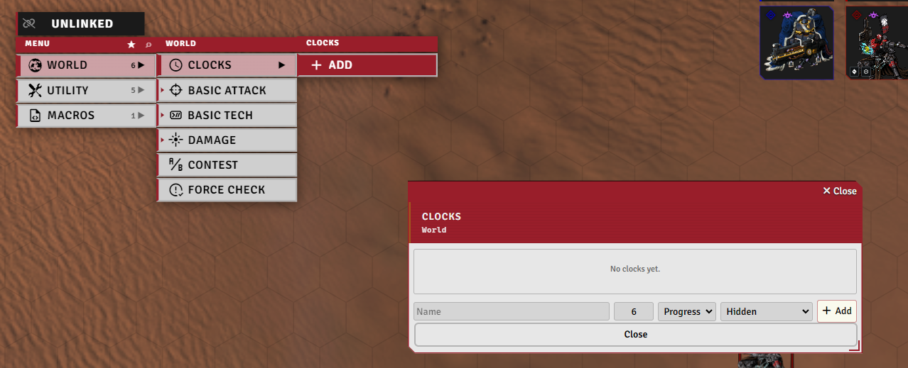
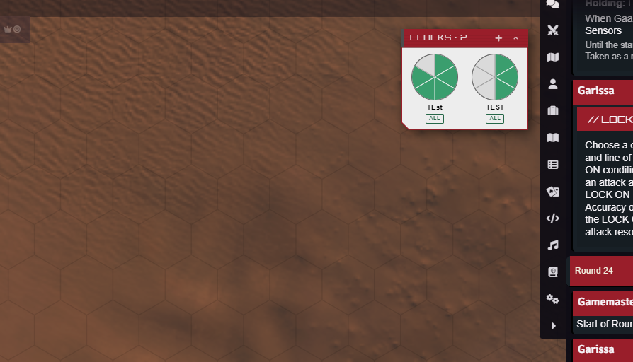
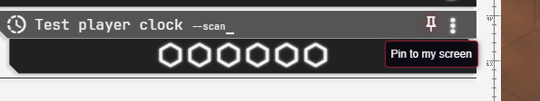

# Clocks

[← Back to Home](../index.md)

World clocks are shared by the whole table. Pilot clocks and burdens can be pinned next to them.

---

## World clocks

The GM adds them from **World > Clocks > Add** in the [narrative TAH](HUD.md#narrative-mode), or from the **+** on the clocks panel.

Each clock has:

- **Segments**: 2 to 12.
- **Color**: Progress (green), Threat (orange) or Neutral (blue).
- **Show on screen**: Hidden, GM only, All players, chosen players or groups. Groups need the Player Groups module.

Right-click a clock to change these, reset it or remove it.

A full clock stays full until the GM resets or removes it. When it fills, a chat message goes to everyone who can see it.

Players can see the clocks shown to them, but can't change them.

---

## Clocks panel

The panel is at the top right. It shows a line of rings or an open list. Its arrow button switches between them.

| Open list | Rings |
|:----------|:------|
|  |  |

- Click a segment to set the value. The GM does this for world clocks, the pilot's owner for pinned clocks.
- Right-click a clock for its menu.
- **Hide this clock for me** only hides it on your screen. The eye button brings hidden clocks back.

---

## Pinned clocks

Click the pin on a pilot clock or burden row in the TAH to add it to your panel. Pins are per user.

Right-click it on the panel and pick **Unpin** to remove it.

---

## API

See [World Clocks](../API_HUD.md#world-clocks).
