# Gameplay Automation

[← Back to Home](../index.md) · Engine: [Automation Engine](./AUTOMATION_ENGINE.md)

Lancer Automations runs the procedural parts of play for you: combat actions and reactions, plus Lancer's own out-of-combat flows for scanning, rest, and downtime. Most are set off by triggers (a move, a hit, the start of a turn) and resolve the rules.

---

## Settings

Most of what this page covers sits on the **Combat & Movement** tab, under **Targeting**, **Attacks**, **Movement & Boost**, and **Structure & Damage**. The rest is on the **Automations** tab, under **Automation Manager** and **Scan**.

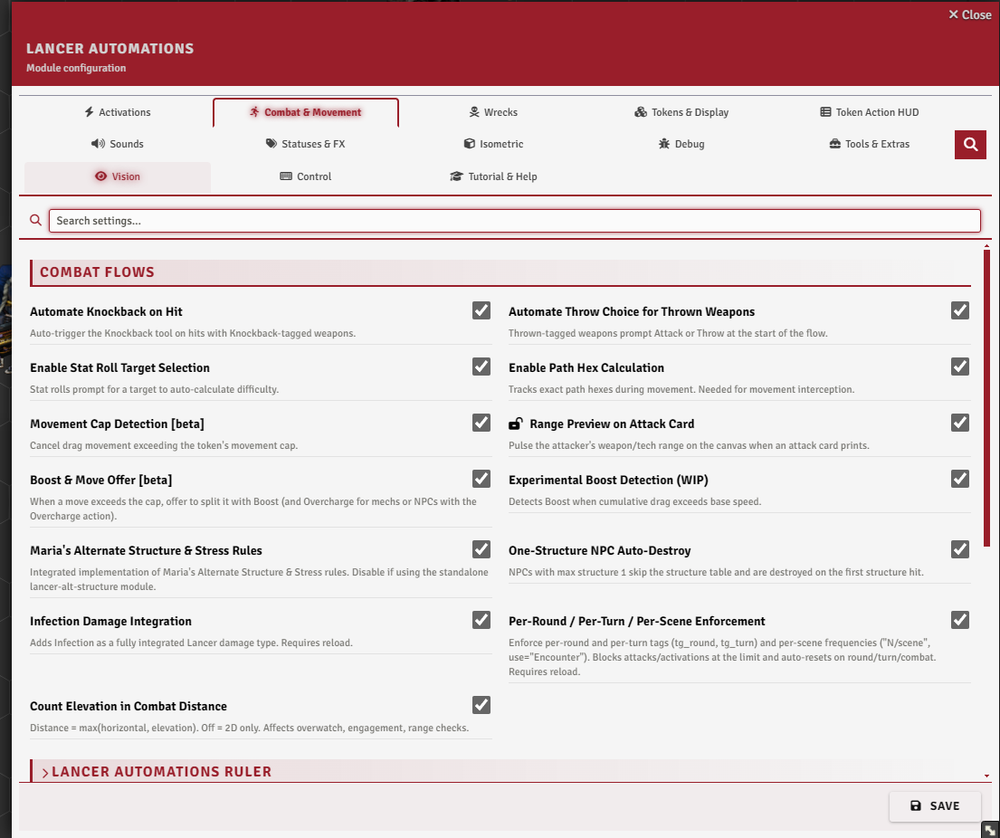

---

## Built-in actions and reactions

Almost all of Lancer's actions and reactions are automated here. These aren't new rules, only Lancer's own actions run for you, and each one can be turned off or rewritten in the Automation Manager (see [Automation Engine](./AUTOMATION_ENGINE.md)). Stabilize and Scan already have a version in the Lancer system, which the module swaps for a fuller one.

  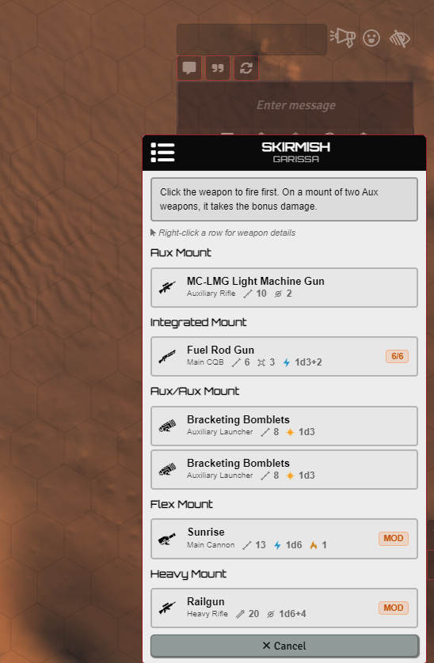
  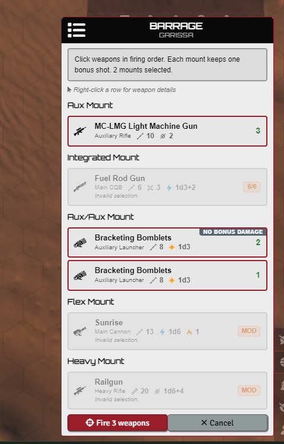
  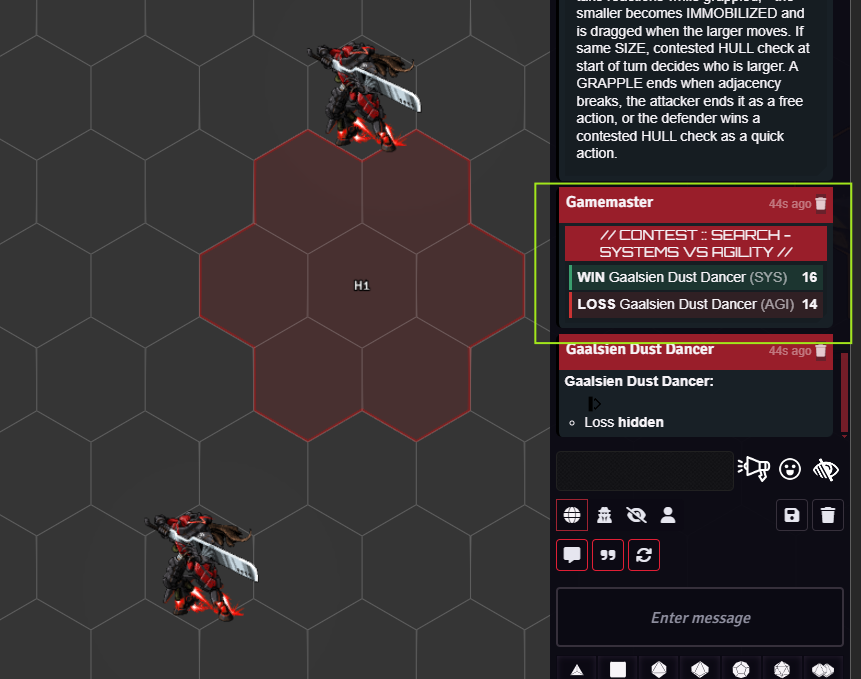
  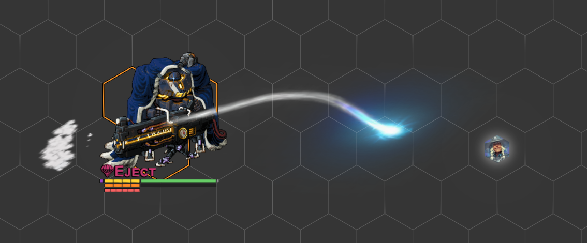

### Checks and combat flows

Search, Break Free, and Lancer's other opposed checks are rolled for you as **stat contests**, and you can trigger one from code with **`executeContestedCheck(tokenA, statA, tokenB, statB)`**, which returns the winner. A tie goes to the one who started the contest (the one breaking free, searching or jockeying), and the chance labels count it.

**Force Check** (TAH Skills, or **`executeForceCheck`**) sends a HASE check to picked tokens, each rolled by its owner. Give it a save target and it becomes a save vs that actor's SAVE, pre-targeted in the roller's HUD.

Auto-knockback (the damage dialog's **Knockback** checkbox, reading a weapon's Knockback tag) is a combat flow covered in [Interactive Tools](./INTERACTIVE_TOOLS.md). Throwing is one too: tick **Thrown** on the attack HUD, and a thrown attack lands the weapon as a token (see [Advanced Targeting and Measurement](./ATTACK_TARGETING.md#throwing)).

With **`autoDamageRoll`** on, the damage roll opens on its own after an attack, and **`autoDamageApply`** applies the rolled damage to the targets. Both are on by default.

---

## Overwatch

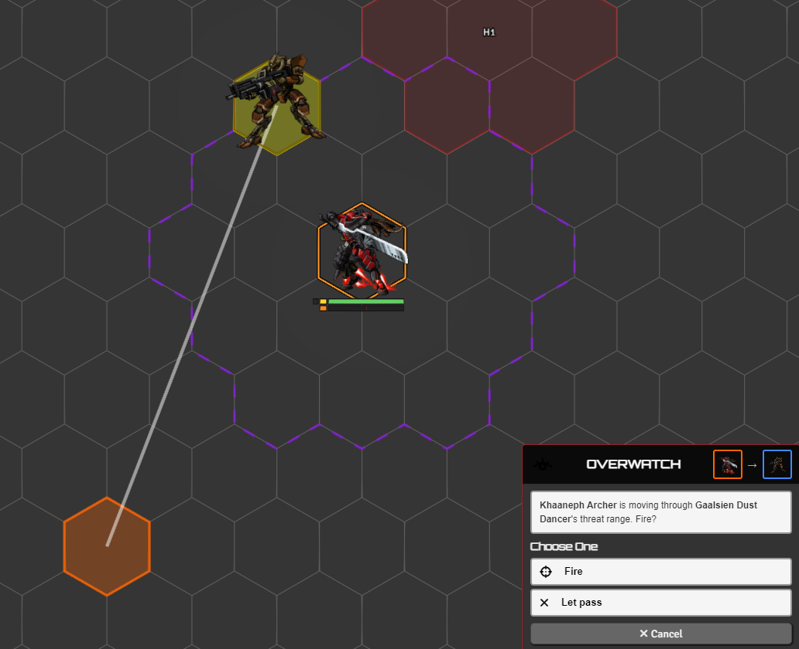

Overwatch is automated two ways, and **both ship disabled**. Enable one in the Automation Manager, or answer the **Movement: Interrupts** step of the setup wizard.

- **Notify after move (v1)**: after a hostile moves inside your threat, an Overwatch activation card prints for the reacting token, with the trigger and effect text. It flags the chance but doesn't stop the move.
- **Interrupt before move (v2)**: pauses the move and asks the owner to **Fire** or **Let pass**, resolving the Skirmish before the move continues.

The wizard enables the one you pick and turns the other off. Threat range reads from Grid-Aware-Auras threat auras when present, otherwise from the actor's weapon threat.

 

---

## Grapple

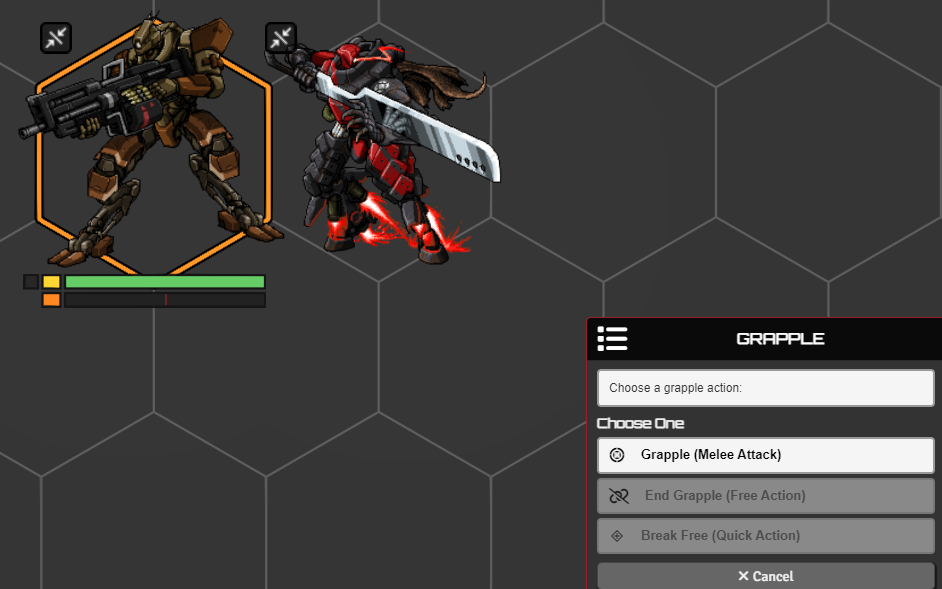

Grapple is automated: on a melee hit it applies **Grappled** and **Grappling**, and **Immobilizes** the smaller side by combined size, with equal sizes settled by a **HULL** contest at the start of each turn.

The immobilized side is dragged along when the controlling side moves, and a knockback breaks the grapple. While you hold someone you get an **End Grapple** row in the TAH Attacks column, and while you're held a **Break Free** row.

A target immune to Grappled is skipped, and there's a Grapple macro too.

 

---

## Prepare

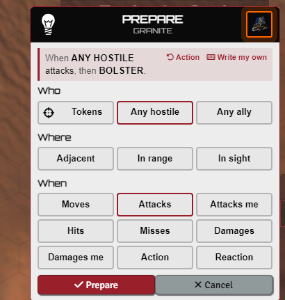

Using **Prepare** opens a card:

1. Pick the action: a basic action, or any quick system, gear or other quick action (search box).
2. Build the trigger as a sentence, **When** [who] [does what], **then** [action]:
    - **Who**: **Any hostile**, **Any ally**, or click **Tokens** on the map.
    - **When**: moves, attacks, attacks me, hits, misses, damages (with a damage type), damages me, takes an action or takes a reaction.
    - **Where** (optional): **Adjacent**, **In sight**, or **In range** of your Threat, Sensors, Max Reach, a weapon or a set range, with or without line of sight. **Already there counts** also fires for a unit already inside.
3. Or click **Write my own** and type the trigger. It is not watched, you use it yourself from the TAH.

 

You get the **Preparing** status until the start of your next turn. While it is on you can't move, take other actions or reactions, or Overcharge, and protocols are locked. The prepared action shows in the status tooltip and under **Reactions** in the TAH. Removing the status drops it.

When the trigger happens you get **Take the prepared action?** with **Use** or **Let pass**. It is taken as a reaction. On a move trigger the mover stops on the hex where it enters range, and goes on after.

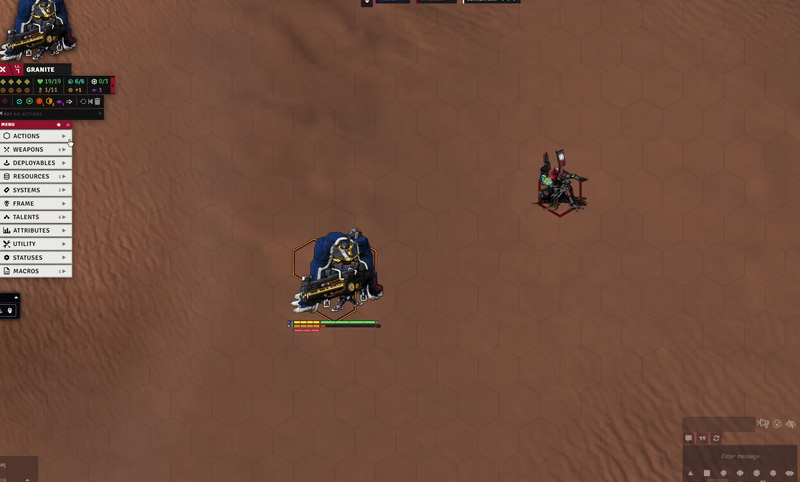

---

## Invade

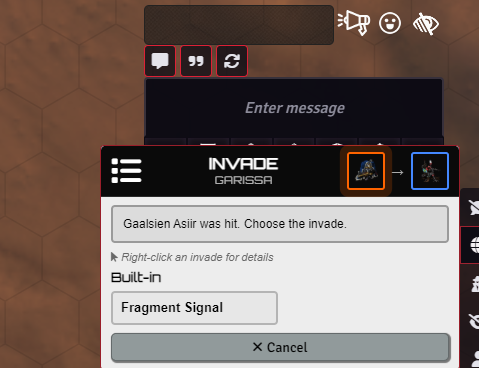

You roll the tech attack first, then pick the invade for each target you hit. A missed target gets nothing.

The chat card shows the chosen invade under each hit target.

 

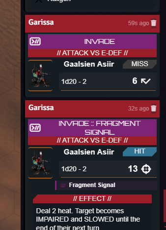

---

## Action limits

**Brace**, **Dazed**, **Stunned**, **Staggered** (Dead Rings), and **Slow** grey out the actions they block in the HUD while the status is on. The action popup names the locking status. Dazed also shows no movement on the ruler.

- **Stunned** locks every action except Mount, Dismount, Eject and Boot Up.
- **Brace** also locks free actions.
- **Overcharge** gives one extra quick action, shown as a +1 pip on Quick in the combat bar. It does not combine into a Full action.
- **Ordnance** weapons grey out once you moved or acted this turn. Firing one anyway, or at a target engaged with you, warns but still fires.

---

## Stabilize

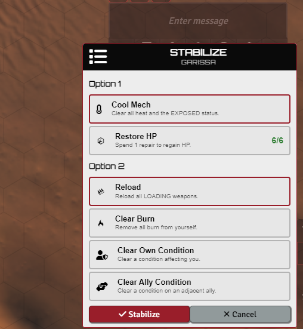

Stabilize gets a clearer card for its two choices. You pick the ally and the condition in the card, and it warns when the ally isn't adjacent. An NPC only cools and reloads. Whether Stabilize spends a Full action is set by **Consume Action on Activation** (`consumeAction`), a world setting under **Automations → Automation Manager** that is on by default and covers every activation flow. With infection integration on, clearing burn also clears [infection](./INFECTION.md).

 

---

## Usage limits

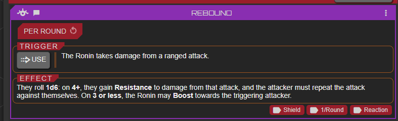

Beyond Lancer's own limited and recharge tracking, weapons and systems tagged **per round**, **per turn**, or **per encounter** get their own pip counters, added straight onto their cards in the actor sheet. Firing the tagged weapon or system ticks a pip, and it's blocked once the pips run out. The pips come back:

- **per round**: at the start of your own turn.
- **per turn**: at the start of every turn, not only yours.
- **per encounter**: when a combat starts or is deleted, not when you change scene.

Turn this off with **Enforce Use Limits** (`enablePerRoundTurnTags`, on by default, needs a reload).

 

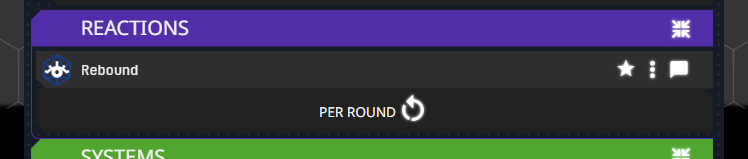

The counters are drawn to match whichever sheet you use, both the default Lancer sheet and the alternate sheet layout.

 

---

## Skip resource consumption

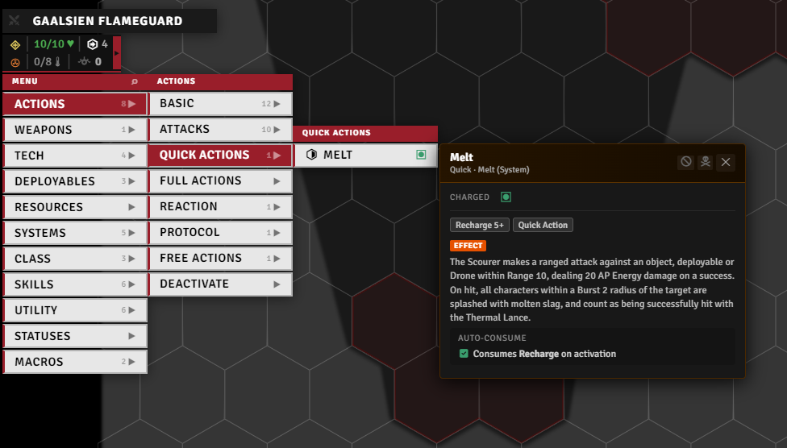

Stop an item from spending its resources when it fires, per resource type. Toggle it from the item's popup in the [Token Action HUD](./HUD.md), or from **Extra Config** on the item sheet (same menu as [Add Extra](./INTERACTIVE_TOOLS.md#add-extra)).

 

---

## Reinforcement

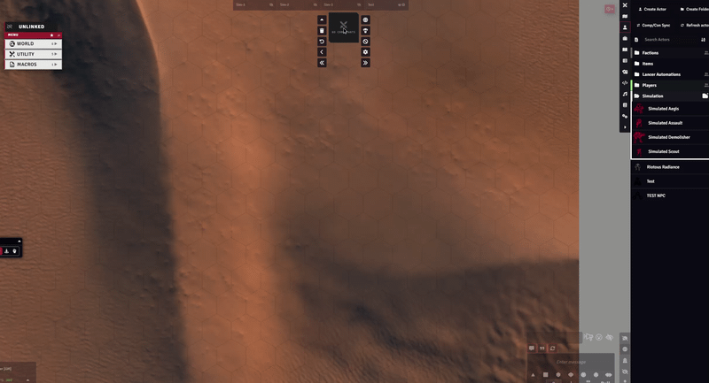

For units that arrive partway through a fight. GM only.

Open the **DROP ON MAP** bar from the combat carousel, **TAH > Utility > Gameplay > Reinforcement**, or the Reinforcement macro. Pick when the units land, a **Round** or a world **Clock** (an existing one, or a **New clock** that can tick at each round change), then drop actors or tokens on the map. Nothing is placed on the scene until they land.

The bar's second row shows the tokens selected on the map. **Add** takes them off the map and plans them as they are, damage, statuses and items included.

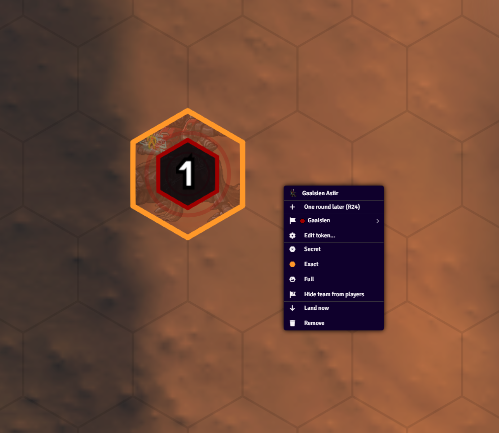

Each planned unit gets a marker with a countdown. Drag it to move the landing spot, double-click it to open its sheet. Right-click it to:

- land it one round sooner or later
- **Edit token…** for this unit only. The prototype token and the actor stay as they are.
- **Edit sheet…** opens its sheet. On an unlinked token the changes stay on this unit only. A linked token opens its actor.
- set what players see: **Secret** (nothing), **Exact** (the marker, not the unit) or **Full** (the unit)
- show or hide its team or disposition from players
- **Land now** or **Remove**

Planned units also show in the carousel.

 

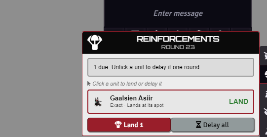

At round change a card lists the units due, along with the units [leaving the battlefield](#leave-battlefield). Each one can land or wait one more round. They come in from the map edge, and land on the nearest free spot if theirs is taken.

 

---

## Leave Battlefield

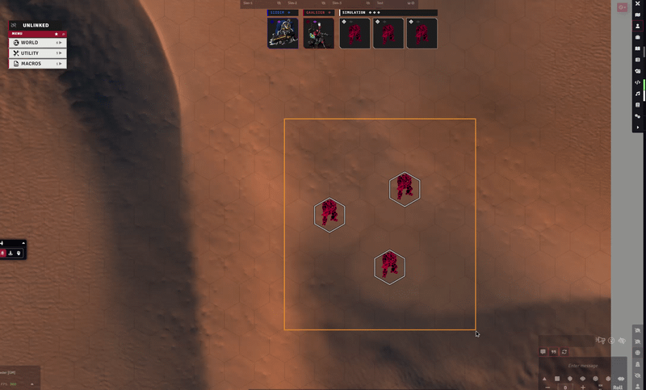

For units that pull out of a fight. Only units in the encounter can leave, and only their owner or the GM can send them.

Use **Leave Battlefield** from **TAH > Utility > Gameplay** or the combat carousel menu. The unit gets the **Leaving** status and pulsing rings on the map. Use it again (**Stay on Battlefield**), or remove the status, to stay.

At the start of the next round the round change card lists the leaving units with the map edge each one takes. Untick one to keep it here. The others move off by the nearest edge and are removed from the scene and the encounter.

The [Battle Log](./BATTLE_LOG.md) records them as **LEFT**, and they are out of the survival awards.

---

## Alt structure & stress

Off by default, **Maria's Alternate Structure & Stress Rules** (`enableAltStruct`, needs a reload) swaps Lancer's structure and overheat rolls for the alternative ruleset, my implementation of BadIdeasBureau and Kaffo's [LANCER Alternative Structure](https://github.com/BadIdeasBureau/lancer-alt-structure). It refuses to load while the standalone `lancer-alt-structure` module is active, so run one or the other.

Both are rolled on keep-lowest tables:

- Structure outcomes run from a glancing blow up to a crushing hit, with **HULL** checks and a system-trauma card where you tear off a weapon or system.
- Stress outcomes cover power failure, emergency shunt, and reactor meltdown, gated by **ENGINEERING** checks and a meltdown countdown.

**One-Structure NPC Auto-Destroy** (`enableOneStructNpc`, on by default) only touches NPCs that already have a max structure of 1: they skip the structure table and are destroyed on the first structure hit. It changes nothing about stress. The matching stress rule, an NPC with max stress 1 going Exposed instead of rolling, is separate and always on.

---

## Scan

  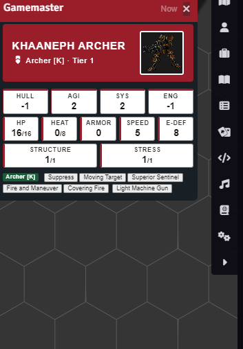
  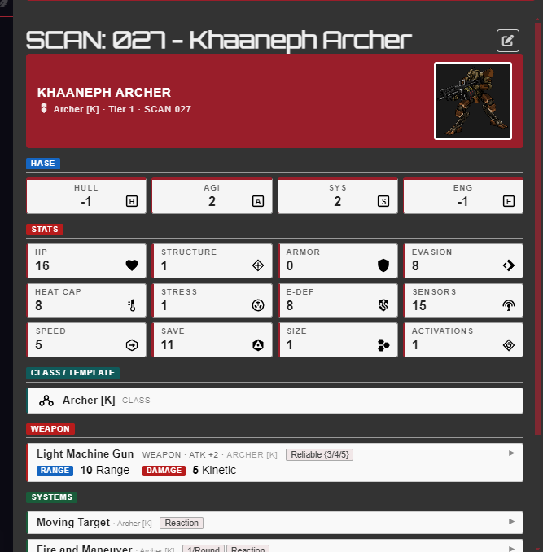

LA's scan runs on both the **legacy** scan and the **native** Lancer-system scan. **`scanJournalSource`** chooses which one produces the result. Each scan is recorded as **scan ownership**, granted to players by **`scanPlayerOwnershipMode`** (everyone, a player group, or only the scanner).

Other LA features read that ownership to tell whether a player may see a target's data, so an NPC's information stays hidden until it's scanned. The [token stat hint](./TOKEN_DISPLAY.md) reads **UNKNOWN** until then, the custom [stat bars](./TOKEN_DISPLAY.md) can be set to appear only once scanned, and the HUD glossary panel lists what you've scanned.

**`scanRevealMode`** (**Count As Scanned Without A Scan**) loosens that gate: **Player tokens**, **Players and allies** (default) or **Everyone** read as scanned without anyone running a scan, and **Nobody** keeps it strict. The glossary still lists only real scans.

---

## Rest

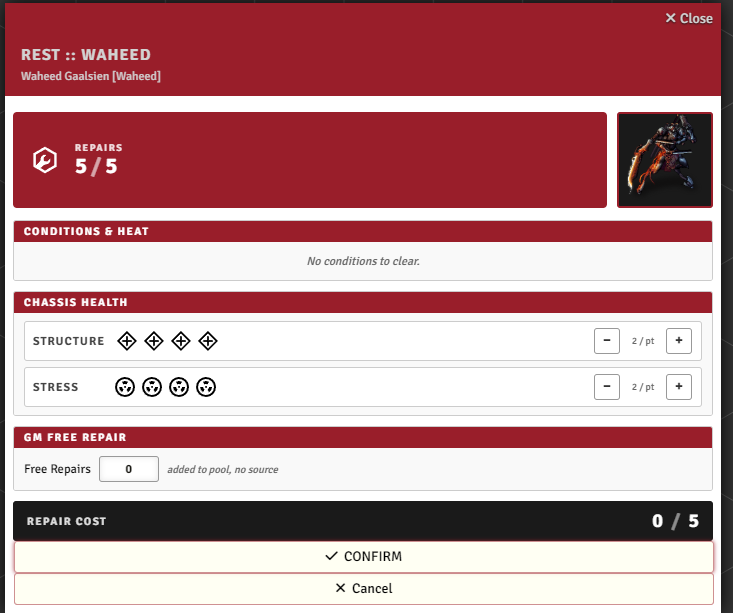

Pick a mech or pilot and open Rest to spend its repair pool. You can pull repairs from nearby allies or have the GM grant more, and at 0 structure or stress it switches to an emergency recovery. A rest report is posted to chat.

 

---

## Downtime

A guided downtime flow: pick the pilot, choose one of the nine downtime activities, set an objective, and roll its skill trigger (with manual-roll and accuracy/difficulty overrides for the GM). The result card shows the outcome and can be logged to a downtime journal, with activity names shown as either in-world or rulebook terms.

Custom activities can be added as Downtime Activity items or imported from an LCP, see [System Additions](./SYSTEM_ADDITIONS.md#custom-downtime-activities).

---

## Reserves

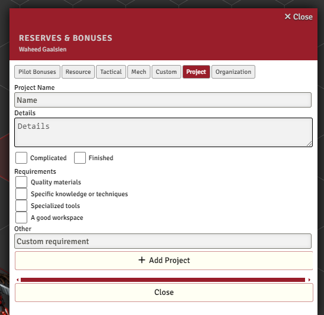

Add Lancer's pilot reserves and bonuses, including custom reserves, projects, and organizations, without opening the compendium. Search to filter, click to add it to the pilot.

 

## Notable options

| Option | What it does |
|:--|:--|
| **Automate Knockback on Hit** | Auto-trigger the Knockback tool on hits with Knockback-tagged weapons. |
| **Auto-Open Damage Roll** | The damage roll opens on its own after an attack. |
| **Auto Apply Damage** | The rolled damage is applied to the targets. |
| **Enforce Use Limits** | Pip counters for per-round, per-turn, and per-encounter tags, blocking use at the limit. Needs a reload. |
| **Maria's Alternate Structure & Stress Rules** | Alternative structure and overheat tables. Needs a reload, and conflicts with the standalone `lancer-alt-structure` module. |
| **One-Structure NPC Auto-Destroy** | NPCs with max structure 1 skip the structure table and are destroyed on the first structure hit. |
| **Consume Action on Activation** | Auto-spend the token's Quick or Full action when an activation flow succeeds. |
| **Scan journal source** | Which scan produces the result: the native Lancer journal or the LA legacy template. |
| **Player scan sharing** | Who gets scan ownership when a player runs a scan. GM scans always grant to all players. |
| **Count As Scanned Without A Scan** | Who reads as scanned without a scan: nobody, player tokens, players and allies, or everyone. |
