# Interactive Tools

[← Back to Home](../index.md) · API: [Interactive API](../API_INTERACTIVE.md)

Cards that ask players to choose or vote, and on-canvas tools to pick, place, and move tokens and zones. Automations and macros call these. The function signatures are in [Interactive API](../API_INTERACTIVE.md).

---

## Settings

The settings named on this page sit on four tabs. **Combat & Movement** holds the targeting and sharing toggles (Targeting section). **Ruler & Measures** holds the measure-toolbar ones (Advanced Measure section). **Tokens & Display** holds the deployable and overlap-picker toggles. The **Colors** tab holds the palette, and it's per-client, so each player sets their own.

---

## Choice cards

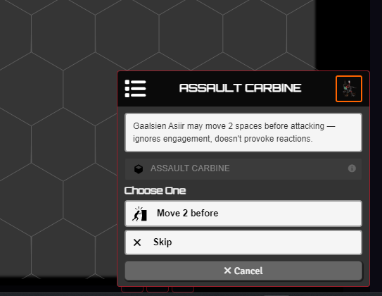

A choice card pauses and waits for a player to pick. `startChoiceCard` has four modes:

- **OR**: pick one option, the card closes.
- **AND**: every option must be clicked. Each runs as soon as it's confirmed.
- **Vote** and **Hidden Vote**: the card is broadcast to its recipients. You watch a live tally and click **Confirm** to resolve (hidden keeps votes secret until then, ties are broken by you).

Its `userIdControl` option routes a card to one player or a list (first to respond wins), `owner` to a token's owner. A non-interactive **waiting card** (`startWaitCard`) shows "waiting for X" in the meantime.

**openChoiceMenu** builds and sends a choice or vote card from a dialog, no code needed.

 

---

## Card and flow stacking

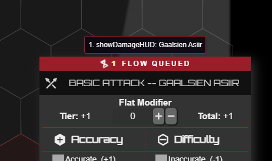

Lancer shows one roll card at a time, and so do these. When several fire at once (an area attack hitting five tokens, or a pile of reactions), they queue instead of overwriting each other, including **attack, damage, and stat-roll** cards and the interactive cards above. A badge on the active card counts how many are still queued.

 

---

## Picking targets and areas

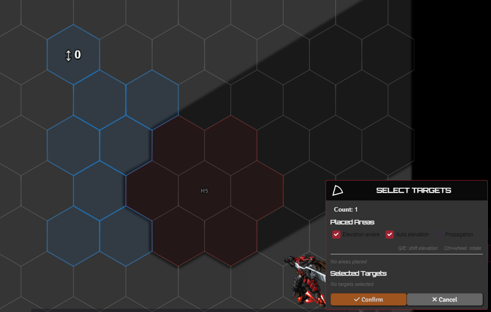

**chooseToken** highlights the valid tokens in range and asks you to pick one or more, with an optional **filter** (allies only, for example).

For area effects it switches to **blast / cone / line / burst**: place the shape on the canvas, drag to aim a cone or line, and toggle **elevation-aware**, **auto-elevation**, and **propagation** (flood-fill that terrain blocks).

**pickSingleTargetToggle** skips the card: click a token to toggle it as your target.

 

---

## HASE contest

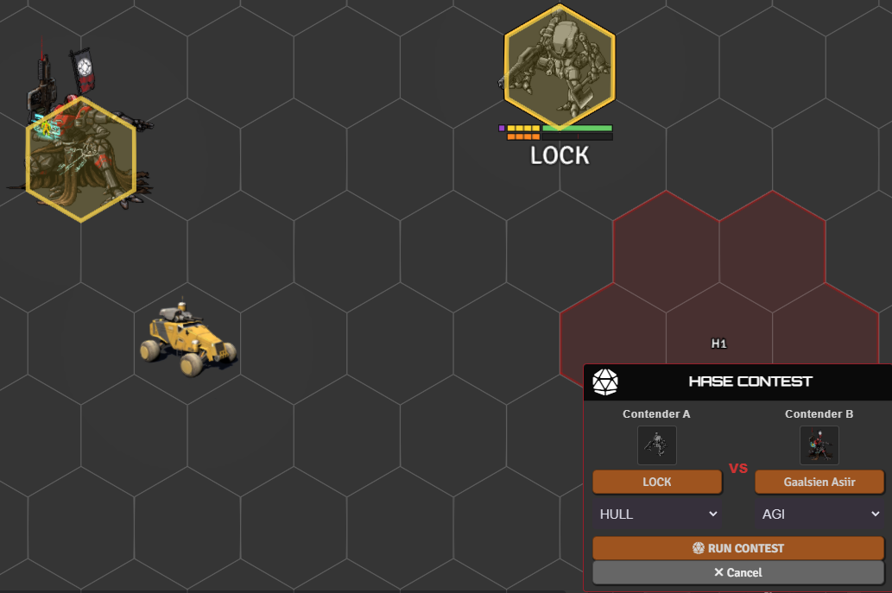

**openHaseContestCard** sets up a contest between two tokens: pick each contender and its HASE stat, roll both sides, and compare. It's reachable from a token's **Contest** entry under Skills. Search, Jockey, Grapple, and Break Free all run through it. A tie goes to the one who started the contest, and the chance labels count it.

 

---

## Force check

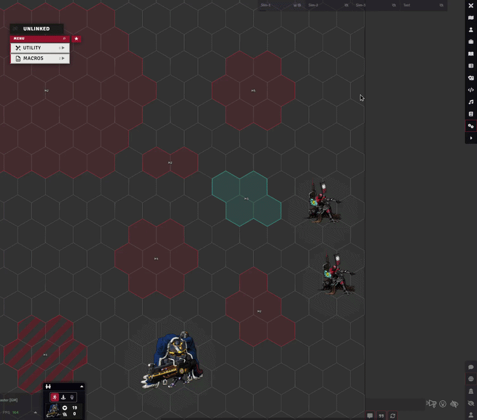

**openForceCheckCard** sends a HASE check to a batch of tokens: pick the skill, pick the targets like an attack roll, and each token's owner rolls it themselves. Give it a save-vs token and every check becomes a save against that actor's SAVE, pre-targeted in the roller's HUD. It's reachable from a token's **Force Check** entry under Skills.

 

---

## Placing zones

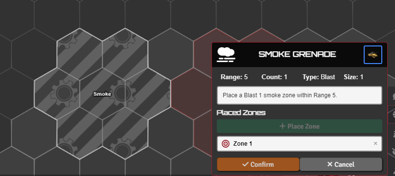

**placeZone** drops Blast / Burst / Cone / Line zones (through TemplateMacro). A zone can apply **status effects** to anyone inside, deal damage as a **dangerous zone**, or mark **difficult terrain** for the [ruler](./MOVEMENT.md). A zone can also follow a token.

For one-off effects you can skip the API: place a template by hand and attach the behaviour to it with [TemplateMacro](https://github.com/Agraael/templatemacro).

 

---

## Moving and knocking back tokens

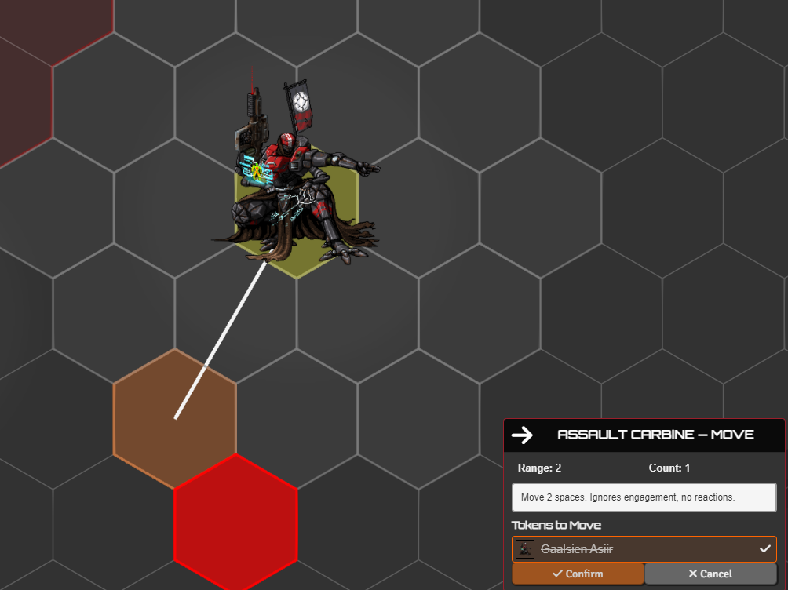

**knockBackToken** pushes or pulls tokens a set distance, one at a time, snapping to the grid and respecting obstacles. The **Knockback** checkbox in the damage dialog reads a weapon's Knockback tag and runs this on hit targets after damage (**Automate Knockback on Hit**, `enableKnockbackFlow`, on by default).

The knockback picker lights the spaces directly away from the attacker, or from the Blast center when the Blast was placed with LA targeting. Other spaces warn but still work.

**placeToken** drops tokens at grid-snapped spots, and **moveToken** moves or teleports a token while drawing a trace from start to destination. The move, knockback, and teleport pickers take **Ctrl+click** waypoints for multi-leg paths. They preview like a drag: the ruler shows for everyone, with a token ghost, Ground/Hold and Q/E.

 

---

## Targeting in attack and check flows

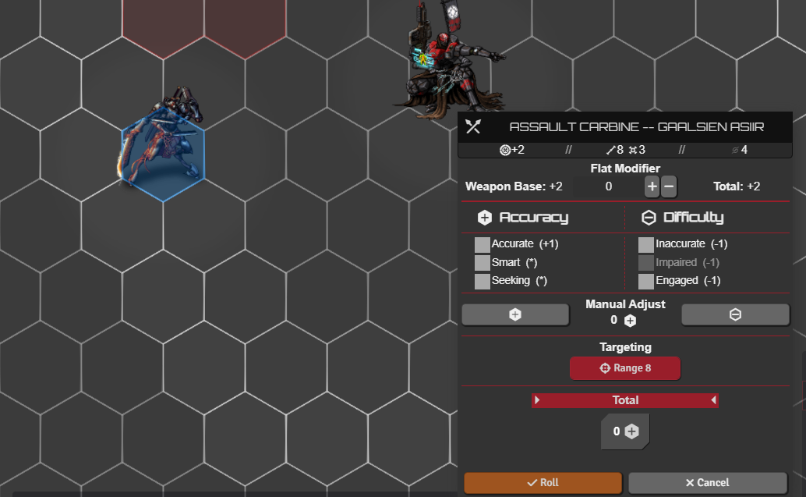

The attack HUD's target and area buttons are covered in [Advanced Targeting and Measurement](./ATTACK_TARGETING.md#the-targeting-buttons). Two related settings:

- **Stat Roll Targeting**: with **`statRollTargeting`** on (default), a stat or skill roll (HULL / AGI / SYS / ENG) gets the same target button as an attack, using the picked token's save or matching stat as the difficulty.
- **Range Preview While Attacking**: with **`tah.rangePreviewOnAttackCard`** on, the attacker's reach is drawn on the canvas when the attack card opens, following the **Thrown** box for a thrown weapon.

 

---

## Colors

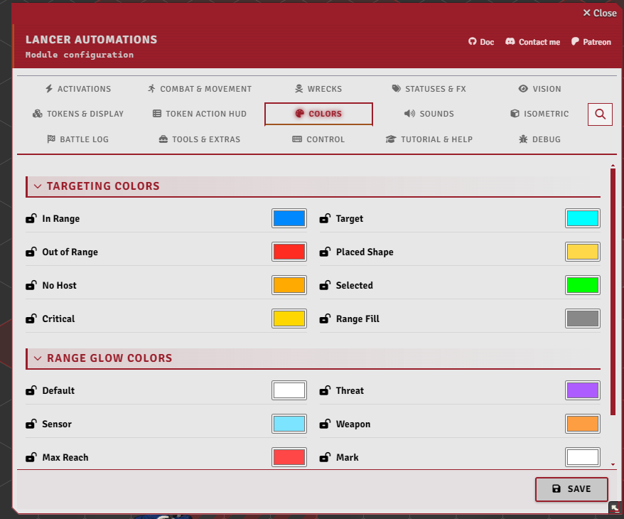

The **Colors** settings tab lets each player recolor the targeting and range-glow palette, with a button to reset them. It also carries the trace colors, the ruler speed-tier colors, the range-pulse style, and the Lancer Style Library theme.

 

---

## Deployables

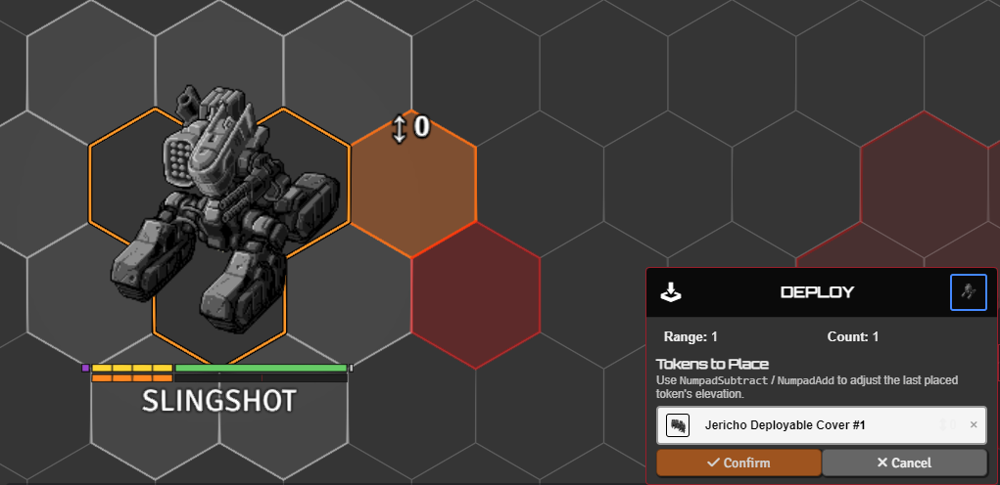

- **Place a deployable**: drop a drone, turret, or other deployable on the field (drones default to sensor range), and recall it when done. A deploy menu lists an actor's deployables.
- **Throw a weapon**: place a thrown weapon as a token on the ground (it's disabled in the sheet while it's out there) and pick it back up later.
- **Hard cover**: spawn a hard-cover token whose HP scales with its size.
- **Extra deployables**: attach extra deployables to an item that doesn't natively carry one, or define a new one from plain data, no LCP needed.
- **NPC sheets**: NPC features show their deployables on the Lancer and Alternative NPC sheets, with deploy and recall buttons, like the mech sheets do.
- **Own moves and actions**: in Add Extra or the item's Extra Config, a deployable can be set to **Moves on its own** (it moves with its own movement while its owner fights) and **Own actions** (its actions do not spend the owner's actions).
- **Deployable TAH**: it shows the owner's portrait and action icons, with **Pickup** for a thrown weapon and **Return to Owner** for a deployable with no Recall.
- **Recall** is an owner action, and **Undo** on a Pickup or a Recall puts the token back. Players can deploy without actor creation rights.

 

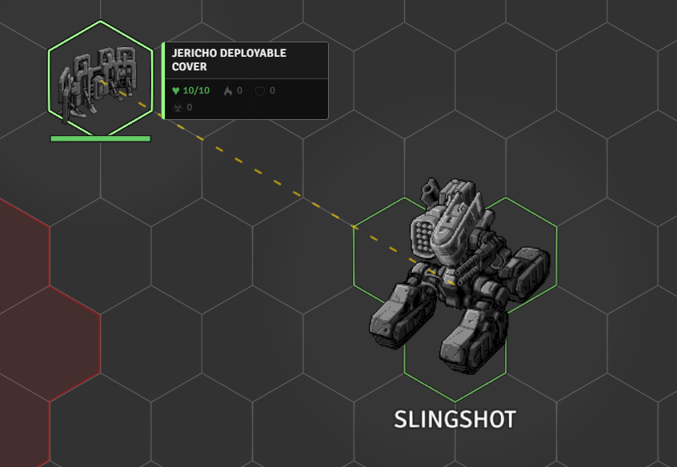

With **`linkManualDeploy`**, a deployable you drag onto the scene yourself links to your token and fires its `onDeploy`, like the deploy menu does. **`showDeployableLines`** draws a line from an owner to its deployables on hover. **`deployableFolderName`** (default "Deployables") is the subfolder of the owner's folder where created deployable actors go. Empty puts them in the owner's folder.

Reinforcement is in [Gameplay Automation](./GAMEPLAY_AUTOMATION.md#reinforcement).

 

### Deployable art

**Default Deployable Art** (`defaultDeployableArt`, **Tokens & Display**, off by default) replaces the default deployable icons with LA token art: drones, mines, turrets, hard cover and thrown weapons.

- Only deployables still on a default icon change. Art you set yourself is kept.
- Thrown weapons get random art for their size.
- Placed tokens are flipped at random, so copies don't all look the same.
- **Default Deployable Art Scale** (`deployableArtScale`, 1.5 by default) sets their token scale.
- **Reapply Deployable Art** runs it again, for deployables added since.

---

## Add Extra

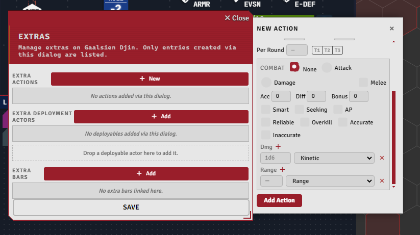

**Add Extra** attaches these to an actor, no code needed:

- **custom actions** (activation type, plus charges, recharge, and limited / per-turn / per-round uses)
- **extra deployables**, by LID or as a **New deployable** built in the dialog (stats, activation, actions, tiers, or pasted LCP JSON)
- **extra resource bars**

It works on a token's actor, on the prototype actor, or directly on an **item**, and it only lists the entries you create here.

Open it from:

- the **L.A** button on the actor or item sheet header, which opens a dialog with **Add Extra**, **Add Effect**, and, on items, **Extra Config**. The button reads **L.A (N)** once something is attached.
- **Token Action HUD (TAH) > Utility > Misc > Add Extra**.

Anything attached to an item is stored on the item and follows it: whoever carries it gets the extras.

Set **Combat** to **Attack** or **Damage** to make an action roll:

- **Attack** rolls a to-hit on your targets, then carries its **Dmg** rows to the damage card.
- **Damage** rolls its **Dmg** rows straight.

**Acc** / **Diff** / **Bonus** and the tag boxes work like a weapon's, and a **Quick Tech** / **Full Tech** / **Invade** activation rolls a tech attack.

The **Action Combat** list does the same for actions the item or actor already has: the pencil attaches the roll. The action itself is untouched and still prints its usual card first.

 

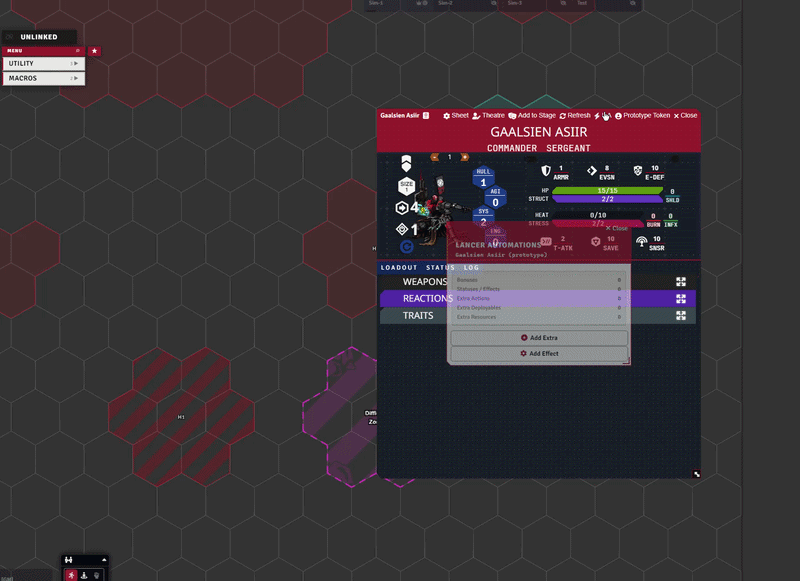

---

## Overlap token picker

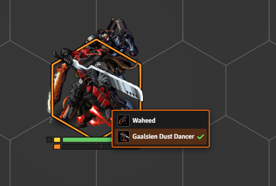

With **`overlapTokenPicker`** on (default), clicking a spot where tokens are stacked shows a small picker so you choose which one.

 

---

## Share Interactive Tools

With **`displayToolsToOthers`** on (the default), your in-progress tools (target picking, zone and token placement, movement traces) show to other players as a faded ghost of the same shapes, so the table can follow what you're aiming at. A hidden caster or hidden tokens are never broadcast.

## Notable options

| Option | What it does |
|:--|:--|
| **Ctrl Ruler** | Hold Ctrl to switch to the Measure Distance ruler. |
| **HUD Scale** | Size of the measure toolbar, shared with the Token Action HUD. |
