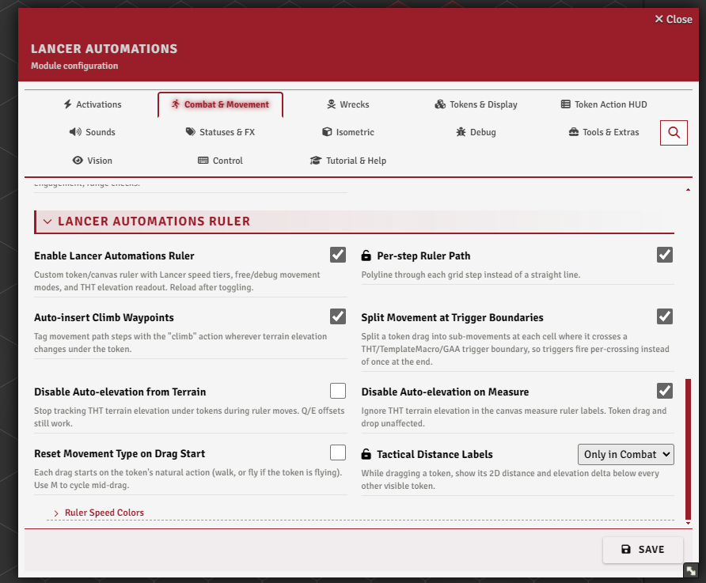
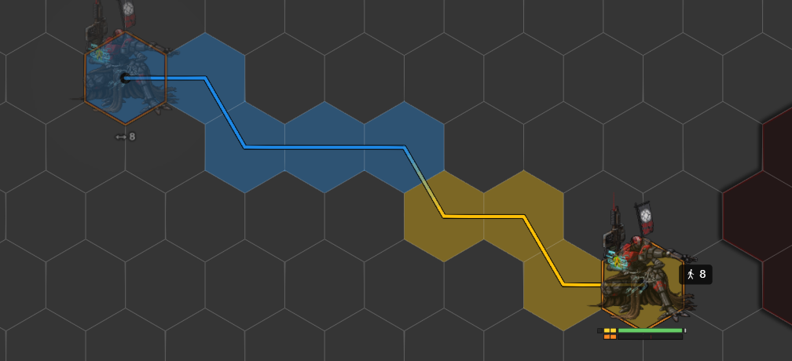
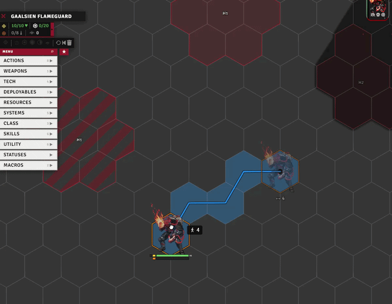
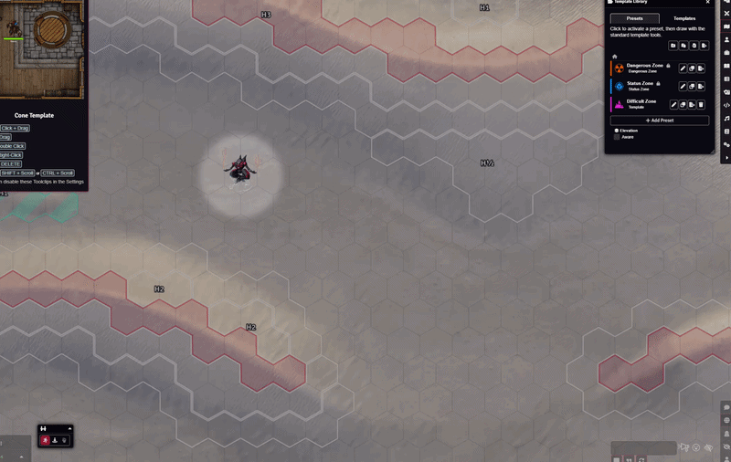
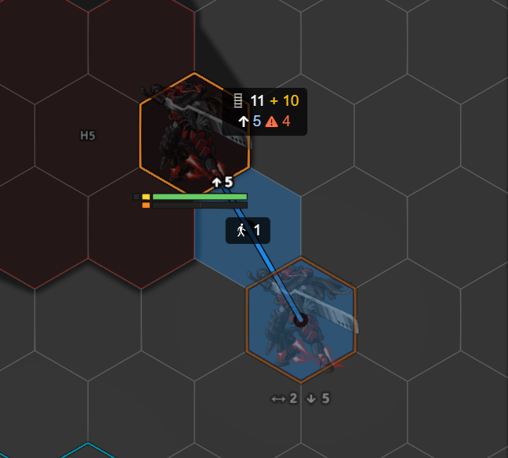
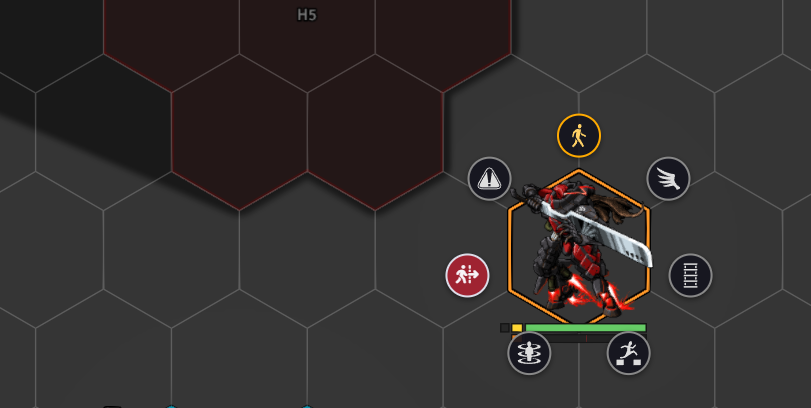
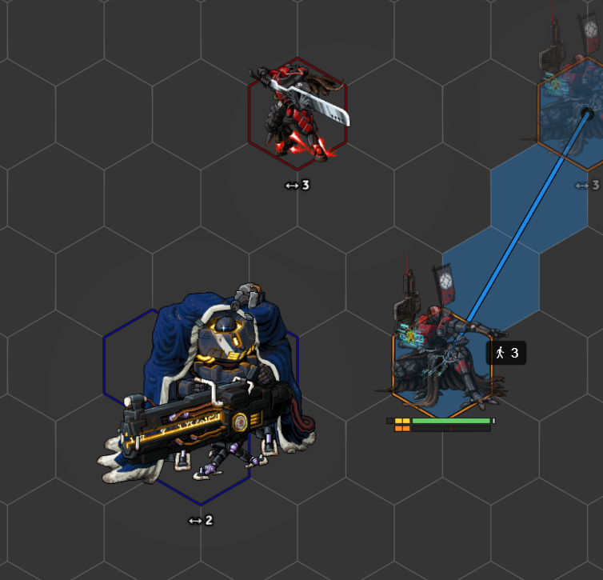
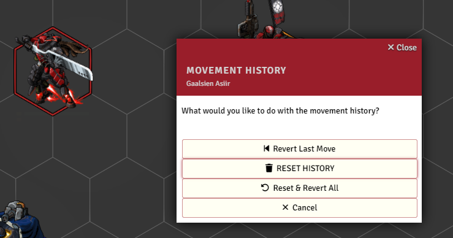

# Movement & the Lancer Ruler

[← Back to Home](../index.md) · Advanced: [Movement Advanced](./MOVEMENT_ADVANCED.md) · Isometric: [Isometric](./ISOMETRIC.md)

Lancer Automations ships its own token and canvas ruler, built around Lancer's speed tiers and elevation. Boost detection, the movement cap, and the debug toggles are in [Movement Advanced](./MOVEMENT_ADVANCED.md).

---

## Settings

**Ruler & Measures → Lancer Automations Ruler**. The path colors live in the **Colors** tab, under **Ruler Colors**.

---

## The Lancer ruler

**Lancer ruler** (`enableBuiltinSpeedProvider`) is on by default. Changing it needs a reload. It conflicts with the standalone lancer-speed-provider module: with both active, the compatibility check offers to disable my ruler, so uninstall or disable lancer-speed-provider if you want to keep mine.

While you drag a token, the ruler shows the **movement cost** and colors the path by **speed tier**: standard, boost, and over-boost (mechs with Overcharge, or NPCs with Limitless). Free and forced moves get their own colors. All five colors are set in **Ruler Colors**, in the **Colors** tab.

Each waypoint label shows the running cost, the delta from your last click, an ↑/↓ elevation change, and a ⚠ marker on cells that cross difficult terrain. **Per-step Ruler Path** (`rulerPerStepRender`, on by default) draws the path through each grid cell instead of a straight line.

Status effects shape the tiers: **prone** halves speed, **slow** removes boost and over-boost, and **stunned**, **immobilized**, **shut down**, **down and out** or **dazed** stop movement entirely.

 

---

## How movement cost is figured

Each step costs:

- its **horizontal** distance,
- its **vertical** distance,
- the worst **difficult-terrain** penalty on the cells it crosses (from Terrain Height Tools, Grid-Aware Auras, TemplateMacro zones, or Foundry region *Modify Movement Cost* behaviors).

By movement type:

- **Walking** adds a climb surcharge: the first unit of a climb is free, each unit after it costs 1 more. A 3-unit climb costs 5 (3 height + 2 surcharge). Flying, the climber status and an elevation immunity bonus remove the surcharge.
- **Flying** follows the highest terrain it crosses and holds altitude over dips. No surcharge.
- **Jumping** one cell across, rising no more than the token's SIZE, costs double the horizontal distance. The climb is free and only the landing cell's terrain counts. A longer or higher jump costs the same as walking.

Pathfinding and reach colors use the same costs. Gridless scenes work too, sampling penalties along the line.

### Low walls

With **Step Over Low Walls** (`enableObstructionStepOver`, on by default), a SIZE 2+ token stands on the lowest hex under its body:

- Terrain under it lower than its SIZE doesn't lift it or cost anything to cross.
- Ending a move on that terrain puts the token on top.
- Terrain as tall as its SIZE or taller is climbed as usual.

It only applies in Ground mode. Flying tokens, SIZE 1 tokens and pilots always climb. The **No Step-over** toggles add NPC templates that always climb too (vehicles, squads, humans and specialists by default), and the `noObstructionPass` flag opts out any token. Both are in **Ruler & Measures → Lancer Automations Ruler**.

Elevation also feeds combat range checks (overwatch, engagement, range) through **Count Elevation in Combat Distance** (`count3DDistance`, on by default), in **Combat & Movement → Movement & Boost**.

The ruler works with my forks of [Grid-Aware Auras](https://github.com/Agraael/FoundryVTT-Grid-Aware-Auras) and [Terrain Height Tools](https://github.com/Agraael/FoundryVTT-Terrain-Height-Tools), plus my [TemplateMacro](https://github.com/Agraael/templatemacro): set difficult terrain by painting it with THT, dropping a GAA aura, or placing a TemplateMacro zone, and the ruler bills the penalty as you cross it.

---

## Elevation

During a drag, **E** raises the token's elevation and **Q** lowers it, by one grid unit per press (the offset resets when the drag starts).

With Terrain Height Tools, the token also **auto-elevates** as you drag, on drop, and when you first place it. It has two modes, picked by the movement action:

- **Ground** - the token stands on a surface. It climbs what it must, goes under overhangs and bridges it fits beneath, and comes down off ledges. Walk, climb, crawl and jump use it. E/Q add on top of the surface.
- **Hold** - the elevation at drag start is a floor. The token rises only where terrain fills its space, comes back to the floor once clear, and never goes below it. Fly uses it. E/Q move the floor.

Press **Z** to swap them for the session. The badge on the last waypoint shows which one is active. You can turn auto-elevation off three ways:

- **Globally** - **Terrain auto-elevation** (`terrainElevationMode`) set to **Off**.
- **Measure ruler only** - the same setting set to **Move only**.
- **One token** - its own **`disableAutoTerrainElevation`** flag, or Terrain Height Tools' own `ignoreAutoElevation`.

**Auto-insert Climb Waypoints** (`enableClimbWaypoints`, on by default) splits the path with `climb` steps wherever terrain height changes, so the cost is billed at each climb. Fly only splits where it rises.

 

---

## Movement types and the wheel

A token moves with a **movement type**: walk, fly, jump, crawl (only while prone), forced, teleport, or ignore-elevation (skips auto-elevation). Gaining a **flying** or **hover** status switches the token to fly automatically, and back to walk when it's removed.

Press **M** outside a drag for the **movement wheel**, a radial picker. During a drag, Foundry's own **Tab** cycles the active type without moving the token (Shift+Tab goes backwards).

 

---

## Keybinds

V, B, M, X and Z are rebindable under **Configure Controls → Lancer Automations**. E and Q are Foundry's own zoom-in / zoom-out keys, so you rebind them under **Core**.

| Key | What it does |
|-----|--------------|
| **V** (hold) | **Free movement** - the next move doesn't spend the movement cap and ignores terrain penalties. |
| **B** (hold) | **Debug movement** - the next move is recorded by Foundry but skips automation (no `onMove`, no history, no engagement update). |
| **M** | **Movement wheel** - open the picker (outside a drag). |
| **Tab** | Cycle the movement type mid-drag. Foundry core key, rebind it under **Core**. |
| **X** | **Toggle Pathfinding** - flips drag pathfinding on or off for this session. Needs Pathfind Drag Movement on. |
| **Z** | **Swap Elevation Mode** - swaps Ground and Hold for this session. |
| **E / Q** | During a drag, raise / lower elevation by one. |

---

## Tactical distance

While you drag a token, **Tactical Distance Labels** (`enableTacticalDistance`) show the distance and elevation delta to every other visible token, right under each one. Set it to **off**, **only in combat**, or **always**.

 

---

## History and revert

Each token's moves are recorded during combat (distance, cost, whether dragged, free, or forced). From the [HUD](./HUD.md) combat bar you can **revert the last move** (retraces the token back along the path it took) or **clear the history**.

History clears on combat start. Two extra world settings clear it at the end of each turn (`historyClearOnTurn`) or the start of each round (`historyClearOnRound`). Neither has a UI row, so set them from the console with `game.settings.set('lancer-automations', 'historyClearOnTurn', true)`.

 

## Notable options

| Option | What it does |
|:--|:--|
| **Split Movement at Speed Tiers** | Split a drag into sub-movements where the ruler speed tier changes. |
| **Tactical Label Position** | Draws the distance label above or below the token. Defaults to below. |
| **Minimum Label Zoom Scale** | Below this zoom level the label keeps a constant screen size. 0 = disabled. |
| **Elevation rounding** | Round the label elevation delta to the nearest multiple of this. Ignored on gridless scenes. |
