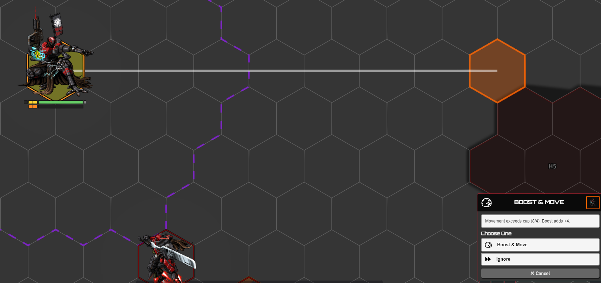

# Movement: Advanced & Beta

[← Back to Home](../index.md) · Main guide: [Movement](./MOVEMENT.md)

Where the settings on this page live:

| Setting | Key | Where |
|:--|:--|:--|
| **Over speed** | `enableBoostOffer` | Combat & Movement → Movement & Boost |
| **Pathfind Drag Movement** | `pathfindDragMovement` | Ruler & Measures → Lancer Automations Ruler |
| **Split Movement at Trigger Boundaries** | `splitMovementAtTriggerBoundaries` | Ruler & Measures → Lancer Automations Ruler |
| **Movement** | `debugMovement` | Debug → Debug Toggles |

Most of this page needs **Lancer ruler** (`enableBuiltinSpeedProvider`) on. See [Movement](./MOVEMENT.md).

> [!WARNING]
> The over-speed check (the first section below) is **beta**. It changes how dragging a token behaves in combat, so test it before relying on it. The rest of the page is not beta.

---

## Movement cap and the offer cards



**Over speed** (`enableBoostOffer`) decides what happens to a drag that would take a combatant past its movement cap. The cap is not a snapshot taken at combat start: it is re-derived on every read from the token's current speed, its statuses (prone halves it, slow removes the boost legs, stunned and friends zero it) and any standing movement bonuses, so a mid-turn speed change moves it. What resets on a turn change is the per-turn legs, not the cap itself.

It has four choices, **Off** by default:

- **Off** - no check.
- **Stop** - the drag is cancelled.
- **Ask to Boost** - an over-cap drag pops a card instead of just being cancelled.
- **Auto Boost** - the same, minus the card: the first option is accepted after a short delay.

The card offers:

- **Boost & Move** - when one Boost would cover the overage. It moves up to the cap, fires the Boost action, then moves the rest.
- **Overcharge & Boost & Move** - for mechs (or NPCs with an Overcharge feature) when one Boost isn't enough but two are. It moves, Boosts, Overcharges, Boosts again, then finishes the move. When the cap is already spent, it starts straight at the Boost.

If neither is enough, the move is rejected with a reminder to hold the free-movement key (the message names your bound key, not a hardcoded V). Choosing **Ignore** on a card runs the full move without the cap check.

<br clear="right"/>

---

## Drag pathfinding

**Pathfind Drag Movement** (`pathfindDragMovement`) routes a dragged token around hostile bodies and tall terrain instead of straight through them. A live overlay shows how far it can still reach as you drag.

It is on by default, and the settings row only shows with both **Lancer ruler** (`enableBuiltinSpeedProvider`) and **Per-step Ruler Path** (`rulerPerStepRender`) on. Press **X** to flip it for the current session while it is on.

---

## Split movement at trigger boundaries

**Split Movement at Trigger Boundaries** (`splitMovementAtTriggerBoundaries`) splits a drag into sub-moves at each cell where the token crosses a trigger boundary - Terrain Height Tools, TemplateMacro, Grid-Aware Auras, or a Foundry region.

The triggers then fire as the token visually reaches each boundary, instead of all at once at the end of the move. The visible path is unchanged.

On hex grids, native regions with movement behaviors can occasionally drift the resolved path from the preview. Stabilization code softens that. The clean fix needs a Foundry source edit, see the last section.

---

## Path hex calculation

Every move records the exact grid cells it passes through, which interception and trigger logic use to know what the token crossed. There is no setting for it, it is always on.

---

## Debug

- **Movement** (`debugMovement`, Debug tab) draws those path cells and the terrain/climb/penalty overlays during a move, and logs the per-cell cost. Do not confuse it with the **Debug Movement** keybind of the same name in the Control tab, which is the B hold that makes one move skip automation.

---

## For developers and self-hosted installs

Pathfinding and splits inject into the drag preview through a wrap of `Token#createTerrainMovementPath`, so no core edit is needed. If a `modifyPlannedMovement` hook fires (the old source patch), LA uses it instead and the wrap stays dormant.

The clean fix for the hex-grid path drift is one hook in Foundry's own source, so it is for self-hosted installs only (`resources/app/public/scripts/foundry.mjs`).

<details>
<summary><b>The source patch</b></summary>

<br>

In **`TokenDocument#splitMovementPath`**, the `if (regionCheckpoint)` block. Match the token-anchored cell offset so an LA waypoint already on the hex suppresses Foundry's sub-pixel checkpoint. Without it you get three dots and a cube-line divergence. Nothing in a module can stand in for it, the block has to be edited in place:

```js
if ( regionCheckpoint ) {
  let _laRC, _laPV, _laCU;
  try {
    _laRC = this._positionToGridOffset(regionCheckpoint);
    _laPV = this._positionToGridOffset(previous);
    _laCU = this._positionToGridOffset(current);
  } catch {}
  const _laSameCellPrev = !!(_laRC && _laPV && _laRC.i === _laPV.i && _laRC.j === _laPV.j);
  const _laSameCellCurr = !!(_laRC && _laCU && _laRC.i === _laCU.i && _laRC.j === _laCU.j);

  if ( (TokenDocument.arePositionsEqual(regionCheckpoint, previous) || _laSameCellPrev) && (previous !== origin) ) {
    previous.checkpoint = true;
    pending.push(current);
  }
  else if ( TokenDocument.arePositionsEqual(regionCheckpoint, current) || _laSameCellCurr ) {
    current.checkpoint = true;
    passed.push(current);
  }
```

Keep the original final `else` and closing brace as-is.

</details>
