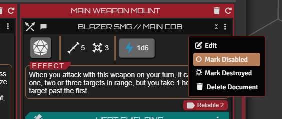
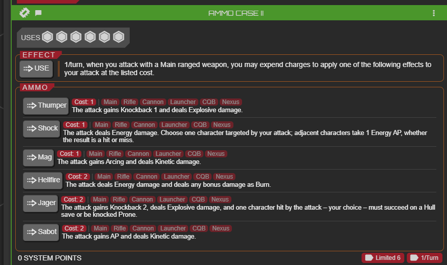
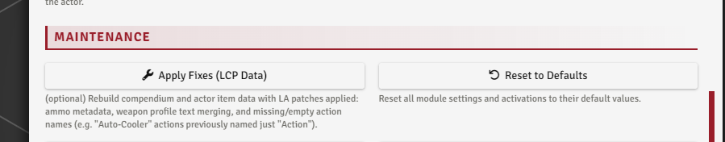
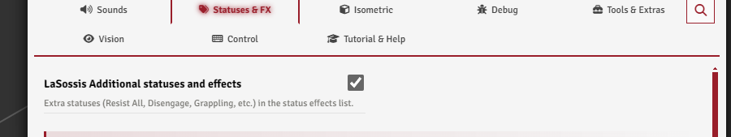
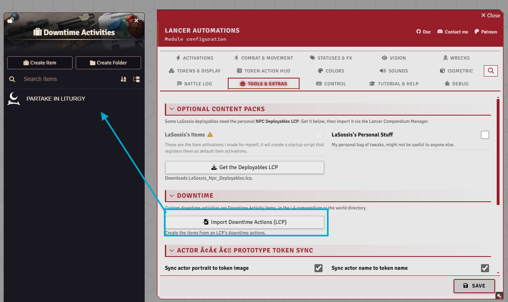

# System Additions

[← Back to Home](../index.md)

A few changes Lancer Automations makes to the Lancer system and its sheets.

---

## Item Disabled

Right-click a mech weapon, mech system, NPC feature, or weapon mod on its sheet to **disable** it. A disabled item dims with a power-off icon and is blocked from every attack and activation flow. A Full Repair clears the flag.

The throw-weapon automation uses it to disable a weapon while it's out on the field.

 

---

## Ammo

Each of a system's **ammo** entries shows on the actor sheet, with a one-click **USE**.

 

A system's ammo is set up on its item sheet. The **Apply Fixes (LCP Data)** tool adds the official ammo descriptions and restriction data to items that ship without them.

 

---

## Extra status effects

None of these are there by default. The **Extra Lancer Statuses** toggle (**`additionalStatuses`**, Statuses & FX tab) adds **Guardian**, **Bulwark** and **Phasing**, plus 19 more on top of Lancer's own, like Immovable, Throttled, Climber, Brace, Dazed, Resist All, and Aided. **Infection** comes with the [Infection Damage Type](./INFECTION.md) setting instead.

Safe to leave off, automations that use them just skip.

Some carry mechanics:

- **Resist All** sets every resistance
- **Throttled** pre-checks Half Damage on the damage card
- **Phasing** moves through other characters in pathfinding and knockback, but can't end its movement on them

Three more aren't added by the module. It only gives them mechanics when the system or an LCP already has them:

- **Shredded** zeroes armor and resistances
- **Stripped** (Dead Rings LCP) zeroes armor
- **Staggered** (Dead Rings LCP) locks actions

 

---

## Custom Downtime Activities

A **Downtime Activity** item type: description, rollable toggle, roll-range result bands. The [downtime flow](./GAMEPLAY_AUTOMATION.md#downtime) lists the core nine plus every such item in the **LA - Downtime Activities** compendium or the world directory. Same-name items override core ones, and a same-name item marked **hidden** removes the core activity.

**Import Downtime Actions (LCP)** (Settings, Tools tab) creates these items from an `.lcp` file. Re-importing updates them.

---

## Permanent statuses

A status whose duration is set to **permanent** (in the [Effect Manager](./EFFECTS_AND_BONUSES.md)) survives a Full Repair.

---

## Extra trackable attributes

**Move** and **reaction** from the action tracker, plus **infection**, are available as token bar options in the Token Config Resources tab. That's for mechs and NPCs. Pilots get **move** only.

---

## Self-heat resistance

With **Resist Self-Inflicted Heat** on (**`resistSelfHeat`**, Combat & Movement → Structure & Damage, on by default), a mech that resists Heat takes half of its own self-inflicted heat, and a mech vulnerable to Heat takes double.

With **Heat as Energy on heatless targets** (**`convertHeatToEnergyOnHeatless`**, same section, on by default), Heat damage becomes Energy against targets with no heat capacity (pilots, biological NPCs), the way Lancer already does for pilots.

## Notable options

| Option | What it does |
|:--|:--|
| **Apply Token Heights to All Actors** | Writes the token height onto every world actor and every placed token in every scene, using the [token height](./VISION.md#token-height-wall-height) rules. |
